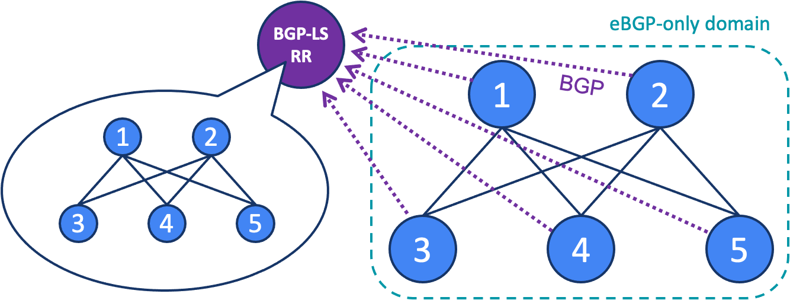

# SONiC BGP-LS eBGP Lab

This repository contains one BGP-LS demo built with SONiC Virtual Switches
(SONiC-VS) and FRR 10.7.1. The eBGP-only fabric has two spines (`R1`, `R2`),
three leaves (`R3`–`R5`), and a BGP-LS route reflector (`RR`). Each fabric
router advertises BGP-LS NLRIs for its node, links, and prefixes to `RR`.



## Requirements

- A Linux Docker host with Docker Compose v2.36 or newer and support for
  IPv6-enabled user-defined networks.

## Repository layout

```text
labs/
└── bgp-ls-ebgp/
    ├── topology.png
    ├── compose.yml
    └── configs/<router>/
        ├── config_db.json
        └── frr.conf
scripts/
├── start-lab
├── node-cli
└── stop-lab
```

Each router's `config_db.json` contains its SONiC interface and loopback
configuration; `frr.conf` contains its FRR routing configuration. The
`start-lab` script starts the lab and applies both configurations to each
router. Use `./scripts/node-cli bgp-ls-ebgp <node>` to open a Bash shell in a
node, for example `./scripts/node-cli bgp-ls-ebgp R3`.

## Start the lab

From the repository root:

```sh
./scripts/start-lab bgp-ls-ebgp
```

After the script completes, allow time for the BGP sessions to establish.
Then inspect the BGP-LS NLRIs that `R3` advertises to `RR`.

## Inspect `R3`

Open a shell in `R3`. At the container prompt, run `vtysh` to enter FRR's CLI:

```sh
./scripts/node-cli bgp-ls-ebgp R3
```

```sh
vtysh
```

First, inspect the BGP-LS peer to `RR`:

```text
R3# show bgp neighbors 2001:db8:3:ff::ff
BGP neighbor is 2001:db8:3:ff::ff, remote AS 65000, local AS 65103, external link
 Description: RR
Hostname: RR
  BGP version 4, remote router ID 10.255.0.254, local router ID 10.255.0.3
  BGP state = Established, up for 00:00:17
...
 For address family: Link-State Link-State
...
  0 accepted, 9 sent prefixes, 0 received duplicates
...
 Connections established 1; dropped 0
```

The session is established, and `R3` sends 9 BGP-LS NLRIs to `RR`.

Now inspect the BGP-LS NLRIs that `R3` advertises to `RR`:

```text
R3# show bgp link-state link-state
BGP table version is 9, local router ID is 10.255.0.3, vrf id 0
     Network          Next Hop            Metric LocPrf Weight Path
 *>  [V][B][I0x0][N[c65103][q10.255.0.3]]
                    ::                                 32768 ?
 *>  [T][B][I0x0][N[c65103][q10.255.0.3]][P[p2001:db8:ffff:3::1/128]][br0x05]
                    ::                                 32768 ?
 *>  [E][B][I0x0][N[c65103][q10.255.0.3]][R[c65102][q10.255.0.2]][L[l7/0][i2001:db8:2:3::3][n2001:db8:2:3::2]]
                    ::                                 32768 ?
...
Displayed 9 routes and 9 total paths
```

`V` is the node, `E` the link, and `T` the prefix. The table contains 9
BGP-LS NLRIs. Type `exit` to return to the container shell, then type
`exit` again to return to the host shell.

## Inspect `R2`

Open a shell in `R2`. At the container prompt, run `vtysh` to enter FRR's CLI;
the prompt changes to `R2#`:

```sh
./scripts/node-cli bgp-ls-ebgp R2
```

```sh
vtysh
```

First, inspect the BGP-LS peer to `RR`:

```text
R2# show bgp neighbors 2001:db8:2:ff::ff
BGP neighbor is 2001:db8:2:ff::ff, remote AS 65000, local AS 65102, external link
 Description: RR
Hostname: RR
  BGP version 4, remote router ID 10.255.0.254, local router ID 10.255.0.2
  BGP state = Established, up for 00:15:47
...
 For address family: Link-State Link-State
...
  0 accepted, 10 sent prefixes, 0 received duplicates
...
 Connections established 1; dropped 0
```

The session is established, and `R2` sends 10 BGP-LS NLRIs to `RR`.

Now inspect the BGP-LS NLRIs that `R2` advertises to `RR`:

```text
R2# show bgp link-state link-state
BGP table version is 10, local router ID is 10.255.0.2, vrf id 0
     Network          Next Hop            Metric LocPrf Weight Path
 *>  [V][B][I0x0][N[c65102][q10.255.0.2]]
                    ::                                 32768 ?
 *>  [T][B][I0x0][N[c65102][q10.255.0.2]][P[p2001:db8:ffff:2::1/128]][br0x05]
                    ::                                 32768 ?
 *>  [E][B][I0x0][N[c65102][q10.255.0.2]][R[c65103][q10.255.0.3]][L[l7/0][i2001:db8:2:3::2][n2001:db8:2:3::3]]
                    ::                                 32768 ?
 *>  [E][B][I0x0][N[c65102][q10.255.0.2]][R[c65104][q10.255.0.4]][L[l8/0][i2001:db8:2:4::2][n2001:db8:2:4::4]]
                    ::                                 32768 ?
 *>  [E][B][I0x0][N[c65102][q10.255.0.2]][R[c65105][q10.255.0.5]][L[l9/0][i2001:db8:2:5::2][n2001:db8:2:5::5]]
                    ::                                 32768 ?
...
Displayed 10 routes and 10 total paths
```

The table includes `R2`'s node, loopback prefix, and links to all
three leaves. Type `exit` to return to the container shell, then type `exit`
again to return to the host shell.

## Inspect `RR`

Open a shell in `RR`. At the container prompt, run `vtysh` to enter FRR's CLI;
the prompt changes to `RR#`:

```sh
./scripts/node-cli bgp-ls-ebgp RR
```

```sh
vtysh
```

Check the BGP-LS peers and the NLRIs received from them:

```text
RR# show bgp summary
...
Link-State Link-State Summary:
BGP router identifier 10.255.0.254, local AS number 65000 VRF default vrf-id 0
BGP table version 47
RIB entries 47
Peers 5, using 150 KiB of memory

Neighbor         V         AS   MsgRcvd   MsgSent   TblVer  InQ OutQ  Up/Down State/PfxRcd   PfxSnt Desc
2001:db8:1:ff::1 4      65101        28        21       47    0    0 00:18:27           10        0 R1
2001:db8:2:ff::2 4      65102        28        21       47    0    0 00:18:27           10        0 R2
2001:db8:3:ff::3 4      65103        27        21       47    0    0 00:18:27            9        0 R3
2001:db8:4:ff::4 4      65104        27        21       47    0    0 00:18:27            9        0 R4
2001:db8:5:ff::5 4      65105        27        21       47    0    0 00:18:27            9        0 R5

Total number of neighbors 5
```

`State/PfxRcd` shows how many BGP-LS NLRIs `RR` received from each fabric
router: 10 from each spine (20 total) and 9 from each leaf (27 total), for
47 NLRIs altogether. Now display `RR`'s BGP link-state table, which contains
the NLRIs received from all five fabric routers:

```text
RR# show bgp link-state link-state
BGP table version is 47, local router ID is 10.255.0.254, vrf id 0
     Network          Next Hop            Metric LocPrf Weight Path
 *>  [V][B][I0x0][N[c65103][q10.255.0.3]]
                    2001:db8:3:ff::3
                                                             0 65103 ?
...
 *>  [V][B][I0x0][N[c65104][q10.255.0.4]]
                    2001:db8:4:ff::4
                                                             0 65104 ?
...
 *>  [V][B][I0x0][N[c65105][q10.255.0.5]]
                    2001:db8:5:ff::5
                                                             0 65105 ?
...
 *>  [V][B][I0x0][N[c65102][q10.255.0.2]]
                    2001:db8:2:ff::2
                                                             0 65102 ?
...
 *>  [V][B][I0x0][N[c65101][q10.255.0.1]]
                    2001:db8:1:ff::1
                                                             0 65101 ?
...
Displayed 47 routes and 47 total paths
```

The BGP link-state table contains the 47 NLRIs received from the five fabric
routers. It includes node (`V`), link (`E`), and prefix (`T`) entries for the
fabric.

To inspect an NLRI, copy its complete bracketed value from the `Network`
column and append it to this command:

```text
RR# show bgp link-state link-state <NLRI>
```

FRR decodes the selected NLRI and displays its type and descriptors. For
example, this node NLRI identifies `R2`:

```text
RR# show bgp link-state link-state [V][B][I0x0][N[c65102][q10.255.0.2]]
NLRI Type: Node
Protocol: BGP
Identifier: 0x0
Local Node Descriptor:
        AS Number: 65102
        BGP Router Identifier: 10.255.0.2
Link-state: Node Name: R2
```

This link NLRI describes the connection from `R1` to `R5`:

```text
RR# show bgp link-state link-state [E][B][I0x0][N[c65101][q10.255.0.1]][R[c65105][q10.255.0.5]][L[l9/0][i2001:db8:1:5::1][n2001:db8:1:5::5]]
NLRI Type: Link
Protocol: BGP
Identifier: 0x0
Local Node Descriptor:
        AS Number: 65101
        BGP Router Identifier: 10.255.0.1
Remote Node Descriptor:
        AS Number: 65105
        BGP Router Identifier: 10.255.0.5
Link Descriptor:
        Link ID: 9.0
        Local Interface Address IPv6: 2001:db8:1:5::1
        Neighbor Interface Address IPv6: 2001:db8:1:5::5
```

This prefix NLRI shows the `R4` loopback learned by `R1`:

```text
RR# show bgp link-state link-state [T][B][I0x0][N[c65101][q10.255.0.1]][P[p2001:db8:ffff:4::1/128]][br0x03]
NLRI Type: Prefix
Protocol: BGP
Identifier: 0x0
Local Node Descriptor:
        AS Number: 65101
        BGP Router Identifier: 10.255.0.1
Prefix Descriptor:
        Prefix: 2001:db8:ffff:4::1/128
        BGP Route Type: External BGP
```

Type `exit` to leave `vtysh` and return to the container shell, then type
`exit` again to return to the host shell.

## Stop the lab

```sh
./scripts/stop-lab bgp-ls-ebgp
```
